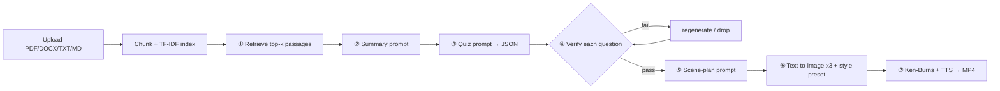

# 🎓 Multimodal Learning-Content Generator

Give it your **course notes** and a **topic** → get a complete lesson package:

| Output | How it is produced |
|---|---|
| 📝 Lesson summary | RAG over uploaded notes, LLM prompt grounded *only* in retrieved passages |
| ❓ Multiple-choice quiz | LLM → **pydantic-validated JSON** → **verified against the notes** |
| 🖼️ Illustrations | Text-to-image with a **standardised style prompt** |
| 🎬 Explainer video | 5–10 s MP4: image sequence (pan/zoom) + captions + TTS narration |

Web UI: **multipage Streamlit app**: an intro page with an interactive 3D graduation cap, then a Lesson Studio page where you upload your PDF and get every modality. Works with Anthropic / OpenAI / Gemini, **or fully offline with no API key**.


## Tested setup (reviewed 8 November 2026)

Verified on Windows with CPython 3.13.9 and Streamlit 1.67.0. The pinned `requirements-lock.txt` reproduces the dependency versions used in the review. The minimum Streamlit version is 1.67 because the results tabs now use stable keys. See `CHECK_REPORT.md` for fixes, validation and remaining limits.

On Windows, extract the folder and double-click `run_windows.bat`, or use these PowerShell commands from the project folder:

```powershell
python -m venv .venv
.\.venv\Scripts\python.exe -m pip install -r requirements-lock.txt
.\.venv\Scripts\python.exe -m streamlit run app.py
```

A text provider's API key is optional. To configure one, copy `.env.example` to `.env` and fill the selected key. For a first test without API keys, upload `sample_data/photosynthesis.md`, select Text LLM = offline, Image model = placeholder, and choose photosynthesis.

## Pipeline (prompt chaining)


Each step consumes the previous step's *validated* output (`lcg/pipeline.py`).

## Requirements → where they are met

| Requirement | Implementation |
|---|---|
| RAG pipeline over uploaded notes | `lcg/ingest.py` (PDF/DOCX/TXT/MD, sentence-aware chunks) · `lcg/retriever.py` (TF-IDF cosine, off-topic guard) |
| Summary + MCQ quiz in **validated JSON** | `lcg/schemas.py` (`Question`, `Quiz`, `Summary`: exactly 4 unique options, valid `answer_index`, mandatory `source_quote`) · `lcg/llm.py::generate_json` extracts JSON, validates, and feeds errors back to the model for self-repair |
| Image module with **standardised style prompts** | `lcg/images.py`: every prompt = *subject + the same `STYLE_PRESET`* + shared negative prompt, fixed 16:9 size, seeded. Backends: OpenAI `gpt-image-1`, HuggingFace FLUX.1-schnell, Pollinations (no key), offline placeholder |
| **5–10 s** video (images + narration) | `lcg/video.py`: duration = clamp(narration + 0.6 s, 5, 10); gTTS (online mode only, bounded timeout) → espeak-ng → silent fallback; H.264 + AAC via ffmpeg |
| Streamlit app integrating everything | `app.py` (router) · `views/home.py` (3D intro, `assets/cap.html`) · `views/studio.py` (upload → Summary · interactive Quiz · Illustrations · Video · Export · Pipeline log) |
| **Quiz correctness verified against source** | `lcg/verify.py` (below) |

### How quiz correctness is verified
A question is shipped only if **all** hold:
1. **Schema** – 4 unique options, valid key, evidence field present (pydantic).
2. **Grounding** – its `source_quote` is found in the notes (exact normalised match, else fuzzy ≥ 0.88). Fuzzy matches use contiguous windows and preserve numbers and negation. This is an automated grounding check, not proof of factual correctness.
3. **Blind judge** – a second call sees *only retrieved evidence + the question* (never the answer key) and must choose the same option. This can reject wrong keys and ambiguous questions, but an LLM judge can still make mistakes.

Failures are **regenerated** (up to 2 rounds, told which questions to avoid) and finally **dropped** — never shown. The UI displays the evidence and verdict per question. Options are also shuffled in code to remove LLM position bias. See `tests/test_core.py::test_verifier_rejects_bad_and_repairs`.

## Quick start

```bash
git clone https://github.com/Tarungowdap/Multimodal-Learning-Content-Generator_prompt_miniproject
cd Multimodal-Learning-Content-Generator_prompt_miniproject
python -m venv .venv && source .venv/bin/activate      # Windows: .venv\Scripts\activate
pip install -r requirements-lock.txt
cp .env.example .env        # add ONE key (Anthropic / OpenAI / Gemini); optional
streamlit run app.py
```
In the app: click **Get started** on the intro page, upload your PDF/DOCX/TXT/MD in the sidebar, pick one of the topics suggested from your document (or type your own, or leave it empty), then click **Generate lesson package**. Nothing is pre-filled.

- **No key?** Choose *Text LLM = offline*: extractive summary + cloze questions that still go through the same verifier. Also select Image model = placeholder for a run without network requests. Offline narration uses espeak/espeak-ng if installed, otherwise the video has captions and silent audio.
- **No GPU needed**: images use hosted models (Pollinations needs no key). For fully offline use, select Image model = placeholder. Online backend errors fall back to styled infographic cards.
- Outputs are saved under `outputs/<topic>/<run-id>/` (`quiz.json`, `lesson.json`, `scene_*.png`, `explainer.mp4`).

## Example quiz JSON
See [`examples/sample_quiz.json`](examples/sample_quiz.json):
```json
{ "question": "...", "options": ["...", "...", "...", "..."], "answer_index": 2,
  "explanation": "...", "source_quote": "<verbatim from notes>", "difficulty": "medium" }
```

## Tests
```bash
python -m pytest -q      # schema, JSON repair, document formats, error recovery, navigation, offline pipeline and video checks
```

## Project layout
```
app.py                  Streamlit router (multipage navigation)
views/home.py           intro page with 3D graduation cap
views/studio.py         upload + generation + results
assets/cap.html         three.js graduation cap
lcg/                    config · ingest · retriever · llm · generators · verify · images · video · pipeline · schemas
sample_data/            two sample course-note files
tests/                  pytest suite (no network needed)
examples/               sample quiz JSON + offline demo video
```

## Limitations / future work
- TF-IDF retrieval is lexical; swap `Retriever` for embeddings (e.g. sentence-transformers + FAISS) for paraphrase-heavy notes.
- Offline mode produces simple fill-in-the-blank questions; LLM mode gives richer conceptual MCQs.
- Text-to-video models (e.g. Veo/Sora/SVD) can replace the image-sequence renderer behind the same `make_video` interface.

## 🌐 Free hosting (Streamlit Community Cloud)
1. Push this repo to GitHub (public).
2. Go to **share.streamlit.io** → *Create app* → pick this repo, branch `main`, file `app.py` → *Deploy*.
3. App → **Settings → Secrets**, paste `GEMINI_API_KEY = "your key"` (free key from aistudio.google.com/apikey).
You get a public URL like `https://<name>.streamlit.app`. (Hugging Face Spaces with the Streamlit SDK works the same way.)
